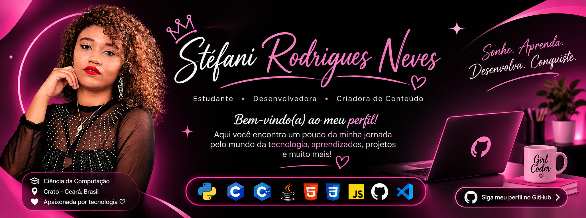

  

  

Olá! Seja muito bem-vindo(a)! 💗

Eu sou Stéfani Rodrigues Neves

Estudante de Ciência da Computação | Desenvolvedora em formação | Apaixonada por tecnologia

📍 Crato – Ceará, Brasil

""GitHub" (https://img.shields.io/badge/GitHub-StefaniNeves-181717?style=for-the-badge&logo=github)" (https://github.com/StefaniNeves)
""LinkedIn" (https://img.shields.io/badge/LinkedIn-Conecte--se-0A66C2?style=for-the-badge&logo=linkedin)" (https://linkedin.com/in/stefani-neves-1aa819333)
""Email" (https://img.shields.io/badge/Email-Fale_comigo-EA4335?style=for-the-badge&logo=gmail&logoColor=white)" (mailto:neves.ste.crato@gmail.com)

---

✨ Um pouquinho sobre mim

Que bom ter você por aqui!

Sou estudante de Ciência da Computação na Universidade Federal do Cariri (UFCA) e estou construindo minha trajetória no universo da tecnologia.

Acredito que aprender é um processo contínuo e que cada projeto representa uma oportunidade de transformar conhecimento em algo real.

Gosto de explorar novas tecnologias, desenvolver soluções, resolver problemas e descobrir até onde a criatividade e a programação podem me levar.

Por aqui, você vai encontrar um pouco da minha evolução, projetos que desenvolvi, experiências acadêmicas e experimentos com programação e Inteligência Artificial.

Ainda estou construindo minha história, mas cada linha de código faz parte dela. 🚀

---

👩‍💻 Minha jornada na tecnologia

- 🎓 Graduanda em Ciência da Computação – UFCA.
- 💻 Desenvolvendo projetos com diferentes linguagens e tecnologias.
- 🤖 Explorando Inteligência Artificial, LLMs e automações.
- 🔌 Estudando integração de APIs e desenvolvimento de aplicações.
- 📚 Sempre aprendendo, praticando e buscando novos desafios.
- 🌱 Em constante evolução como desenvolvedora.

---

🚀 Projetos em destaque

Estes são alguns dos projetos que fazem parte da minha jornada. Cada um representa conhecimentos colocados em prática e desafios que me ajudaram a evoluir.

🤖 01. Assistente de Atendimento com IA

Um projeto voltado à aplicação de Inteligência Artificial no atendimento ao usuário.

- Desenvolvimento em Python e Flask.
- Integração com API da OpenAI.
- Utilização de contexto e perguntas frequentes.
- Organização de respostas e dados em JSON.

🔗 "Acessar projeto" (https://github.com/StefaniNeves/Portfolio-ai-Builder/tree/main/01_assistente_atendimento_ia)

⚙️ 02. Automação de Triagem com IA

Automação de processos para receber, classificar e organizar solicitações.

- Construção de fluxo utilizando n8n.
- Recebimento de dados por Webhook.
- Integração com API de IA.
- Classificação de categorias e prioridades.
- Retorno de informações estruturadas em JSON.

🔗 "Acessar projeto" (https://github.com/StefaniNeves/Portfolio-ai-Builder/tree/main/02_automacao_triagem_ia)

📊 03. AI Business Manager

Uma aplicação para apoiar a análise e o gerenciamento de informações de negócios com recursos de Inteligência Artificial.

- Backend desenvolvido com Python e FastAPI.
- Interface construída com Streamlit.
- Organização e análise de dados.
- Estrutura preparada para integrações com provedores de IA.
- Modo de demonstração para explorar o projeto.
- Documentação e testes.

🔗 "Acessar projeto" (https://github.com/StefaniNeves/Portfolio-ai-Builder/tree/main/03_ai_business_manager)

Quer conhecer os três projetos juntos?

""Portfolio" (https://img.shields.io/badge/VER_MEUS_PROJETOS_DE_IA-FF4FA3?style=for-the-badge&logo=github&logoColor=white)" (https://github.com/StefaniNeves/Portfolio-ai-Builder)

---

🧩 Outros projetos acadêmicos

Além dos projetos de Inteligência Artificial, também participo de trabalhos acadêmicos em equipe, colocando em prática conceitos de programação, lógica e desenvolvimento.

Projeto| Minha contribuição
"Paint com OpenGL" (https://github.com/StefaniNeves/paint_opengl)| Desenvolvimento das funções de criação de objetos primitivos e salvamento e carregamento de arquivos.
"Trabalho de Lógica" (https://github.com/StefaniNeves/Trabalho_logica)| Desenvolvimento dos arquivos "regras.py" e "formulas.py".

---

🛠️ Tecnologias e ferramentas

Linguagens de programação

"Python" (https://img.shields.io/badge/Python-3776AB?style=for-the-badge&logo=python&logoColor=white)
"Java" (https://img.shields.io/badge/Java-ED8B00?style=for-the-badge&logo=openjdk&logoColor=white)
"C" (https://img.shields.io/badge/C-A8B9CC?style=for-the-badge&logo=c&logoColor=black)
"C++" (https://img.shields.io/badge/C++-00599C?style=for-the-badge&logo=cplusplus&logoColor=white)
"JavaScript" (https://img.shields.io/badge/JavaScript-F7DF1E?style=for-the-badge&logo=javascript&logoColor=black)
"C#" (https://img.shields.io/badge/C%23-239120?style=for-the-badge&logo=csharp&logoColor=white)
"PHP" (https://img.shields.io/badge/PHP-777BB4?style=for-the-badge&logo=php&logoColor=white)

Desenvolvimento e tecnologias

"HTML5" (https://img.shields.io/badge/HTML5-E34F26?style=for-the-badge&logo=html5&logoColor=white)
"CSS3" (https://img.shields.io/badge/CSS3-1572B6?style=for-the-badge&logo=css3&logoColor=white)
"Flask" (https://img.shields.io/badge/Flask-000000?style=for-the-badge&logo=flask&logoColor=white)
"FastAPI" (https://img.shields.io/badge/FastAPI-009688?style=for-the-badge&logo=fastapi&logoColor=white)
"Streamlit" (https://img.shields.io/badge/Streamlit-FF4B4B?style=for-the-badge&logo=streamlit&logoColor=white)

Inteligência Artificial e automação

"OpenAI" (https://img.shields.io/badge/OpenAI-412991?style=for-the-badge&logo=openai&logoColor=white)
"n8n" (https://img.shields.io/badge/n8n-EA4B71?style=for-the-badge&logo=n8n&logoColor=white)
"REST API" (https://img.shields.io/badge/REST_APIs-005571?style=for-the-badge)
"JSON" (https://img.shields.io/badge/JSON-000000?style=for-the-badge&logo=json&logoColor=white)

Banco de dados e ferramentas

"PostgreSQL" (https://img.shields.io/badge/PostgreSQL-4169E1?style=for-the-badge&logo=postgresql&logoColor=white)
"MySQL" (https://img.shields.io/badge/MySQL-4479A1?style=for-the-badge&logo=mysql&logoColor=white)
"Git" (https://img.shields.io/badge/Git-F05032?style=for-the-badge&logo=git&logoColor=white)
"GitHub" (https://img.shields.io/badge/GitHub-181717?style=for-the-badge&logo=github&logoColor=white)
"Docker" (https://img.shields.io/badge/Docker-2496ED?style=for-the-badge&logo=docker&logoColor=white)
"Linux" (https://img.shields.io/badge/Linux-FCC624?style=for-the-badge&logo=linux&logoColor=black)

---

📈 Meu GitHub em números

---

🌷 Um pouco além do código

A tecnologia é uma das minhas grandes paixões, mas também acredito na importância de ter curiosidade, criatividade e vontade de conhecer coisas novas.

Gosto de aprender, compartilhar experiências e transformar ideias em projetos.

Meu objetivo é continuar crescendo profissionalmente, desenvolver soluções que façam a diferença e construir uma trajetória da qual eu possa me orgulhar.

---

💌 Vamos nos conectar?

Se você chegou até aqui, muito obrigada pela visita!

Fique à vontade para explorar meus repositórios, conhecer meus projetos, acompanhar minha evolução e trocar experiências comigo.

Se algum projeto chamou sua atenção, deixe uma ⭐. Isso ajuda muito!

E, se você também gosta de tecnologia, programação e inovação, será um prazer ter você acompanhando minha jornada por aqui.

💗 Gostou do que encontrou?

Então não vá embora sem me seguir!

""Seguir no GitHub" (https://img.shields.io/badge/SEGUIR_STÉFANI_NO_GITHUB-FF4FA3?style=for-the-badge&logo=github&logoColor=white)" (https://github.com/StefaniNeves?tab=follow)

""LinkedIn" (https://img.shields.io/badge/VAMOS_NOS_CONECTAR_NO_LINKEDIN-0A66C2?style=for-the-badge&logo=linkedin&logoColor=white)" (https://linkedin.com/in/stefani-neves-1aa819333)

Obrigada por fazer parte dessa jornada! ✨

Sonhe. Aprenda. Desenvolva. Inove.

